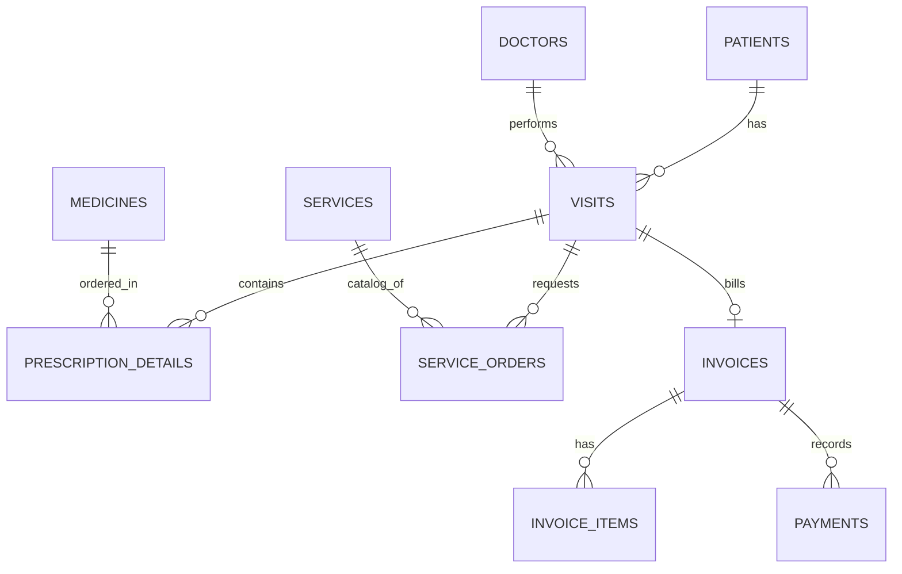

# TỔNG QUAN HỆ THỐNG QUẢN LÝ PHÒNG KHÁM (CLINICMS)

Tài liệu này cung cấp cái nhìn chi tiết và toàn diện nhất về mặt kỹ thuật, kiến trúc, cơ sở dữ liệu, quy trình nghiệp vụ (User Flow), và giao diện (UI/UX) của ứng dụng **ClinicMS**.

---

## 1. TỔNG QUAN CÔNG NGHỆ (TECH STACK)

*   **Framework chính:** .NET 8.0 (Windows Presentation Foundation - WPF)
*   **Ngôn ngữ:** C# 12
*   **Mô hình kiến trúc:** MVVM (Model-View-ViewModel) giúp tách biệt rõ ràng giữa thiết kế giao diện (XAML) và logic nghiệp vụ.
*   **Cơ sở dữ liệu:** SQLite (Cơ sở dữ liệu nhúng dạng file đơn giản, gọn nhẹ).
*   **Object-Relational Mapping (ORM):** Entity Framework Core 8.0 (EF Core) kết hợp Fluent API để ánh xạ thực thể.
*   **Xuất bản PDF:** QuestPDF (Thư viện sinh tài liệu PDF mạnh mẽ dựa trên layout bất đồng bộ).
*   **Nhật ký hệ thống (Logging):** Serilog (Ghi log hàng ngày vào thư mục AppData/Local).
*   **Dependency Injection (DI):** Microsoft.Extensions.DependencyInjection của .NET Core.

---

## 2. CẤU TRÚC THƯ MỤC DỰ ÁN

```text
ClinicMS/
├── Data/               # Lớp truy cập dữ liệu (ClinicDbContext, cấu hình Fluent API)
├── Models/             # Các lớp thực thể (Entities) biểu diễn dữ liệu của cơ sở dữ liệu
├── ViewModels/         # Logic điều khiển, xử lý dữ liệu và giao tiếp với View
├── Views/              # Các file thiết kế giao diện XAML & Logic Code-behind bổ trợ
├── Services/           # Các dịch vụ nghiệp vụ dùng chung
│   ├── PdfExport/      # Logic sinh tài liệu PDF (Đơn thuốc, Bệnh án, Hóa đơn)
│   └── ...             # Các dịch vụ Database, Toast, Modal, Theme, FontScale
├── Converters/         # Bộ chuyển đổi dữ liệu hiển thị (Binding Converters)
├── Resources/          # Tài nguyên chung của app (Màu sắc, Style Controls, Icon)
├── ClinicMS.Tests/     # Dự án kiểm thử Unit Test (sử dụng xUnit)
├── clinic_database.db  # File cơ sở dữ liệu SQLite trong môi trường debug
└── memory.md           # Nhật ký chỉnh sửa & tối ưu hóa hệ thống
```

---

## 3. CƠ SỞ DỮ LIỆU & MÔ HÌNH THỰC THỂ (DATABASE SCHEMA)

Toàn bộ tên bảng và tên cột được chuẩn hóa dưới dạng **chữ thường (lowercase)** để tương thích hoàn hảo giữa SQLite và EF Core.

### 3.1. Sơ đồ các bảng chính và mối quan hệ



### 3.2. Chi tiết các Entity trong [Models/](file:///e:/ClinicMS/Models/)

1.  **Patient (Bệnh nhân) - `patients`:**
    *   `PatientId` (Int, PK, Autoincrement): Mã định danh.
    *   `FullName`, `Gender`, `DateOfBirth`, `PhoneNumber`, `Address`: Thông tin cá nhân.
    *   `MedicalHistory` (Tiểu sử bệnh), `Pulse`, `BloodPressure`, `Temperature`, `Weight`: Các chỉ số sinh hiệu gần nhất.
2.  **Doctor (Bác sĩ) - `doctors`:**
    *   `DoctorId` (Int, PK, Autoincrement), `FullName`, `Specialty` (Chuyên khoa), `PhoneNumber`, `Email`, `IsActive`.
3.  **Visit (Hồ sơ khám) - `visits`:**
    *   `VisitId` (Int, PK, Autoincrement), `PatientId` (FK), `DoctorId` (FK), `AppointmentId` (FK, Nullable).
    *   `VisitTime` (DateTime dạng String), `VisitType` (Khám trực tiếp / Tái khám / Hẹn trước / Cấp cứu).
    *   `Status` (Waiting / In Progress / Completed).
    *   `Symptoms` (Triệu chứng), `Diagnosis` (Chẩn đoán), `Note` (Lời dặn).
    *   `Pulse`, `BloodPressure`, `Temperature`, `Weight`: Sinh hiệu tại thời điểm khám.
4.  **Medicine (Thuốc) - `medicines`:**
    *   `MedicineId` (Int, PK, Autoincrement), `MedicineName`, `Unit` (Đơn vị tính: Viên, Chai, Vỉ...), `UnitPrice`, `StockQuantity` (Số lượng tồn kho), `UsageInstructions` (Hướng dẫn sử dụng mặc định).
5.  **PrescriptionDetail (Chi tiết đơn thuốc) - `prescription_details`:**
    *   **Khóa chính hỗn hợp (Composite PK):** (`VisitId`, `MedicineId`).
    *   `Quantity` (Số lượng kê), `Dosage` (Liều lượng & cách dùng cụ thể).
6.  **Service (Dịch vụ cận lâm sàng) - `services`:**
    *   `ServiceId` (Int, PK), `ServiceName`, `Price`, `Description`.
7.  **ServiceOrder (Chỉ định dịch vụ) - `service_orders`:**
    *   `ServiceOrderId` (Int, PK), `VisitId` (FK), `ServiceId` (FK), `OrderTime`, `Result` (Kết quả cận lâm sàng), `Status`.
8.  **Invoice (Hóa đơn) - `invoices`:**
    *   `VisitId` (Int, PK/FK): Mỗi ca khám (`Visit`) liên kết 1-1 với một hóa đơn.
    *   `TotalAmount` (Tổng tiền), `PaidAmount` (Tiền đã thanh toán), `Status` (Unpaid / Paid / Partial), `CreatedAt`.
9.  **InvoiceItem (Chi tiết hóa đơn) - `invoice_items`:**
    *   **Khóa chính hỗn hợp:** (`VisitId`, `ItemType`, `ItemId`).
    *   `ItemName`, `Quantity`, `UnitPrice`, `Subtotal`.
10. **Payment (Thanh toán) - `payments`:**
    *   `PaymentId` (Int, PK), `VisitId` (FK - Invoice), `Amount` (Số tiền đóng), `PaymentMethod` (Cash / Transfer), `PaymentTime`.

---

## 4. QUẢN LÝ VÒNG ĐỜI & DỊCH VỤ HỆ THỐNG

### 4.1. Khởi động và Đăng ký DI ([App.xaml.cs](file:///e:/ClinicMS/App.xaml.cs))
Ứng dụng sử dụng cấu hình IOC Container để quản lý vòng đời các đối tượng:
*   **Singleton (Tồn tại suốt vòng đời app):**
    *   `DatabaseService`: Quản lý kết nối SQLite, khởi tạo DB và thực hiện nâng cấp schema.
    *   `ToastService`: Hiển thị thông báo Toast góc màn hình không chặn luồng chính.
    *   `ModalService`: Quản lý việc bật/tắt các Dialog dạng Overlay.
    *   `MainViewModel`: Điều phối chính cho thanh menu bên và Font Zoom.
*   **Transient (Khởi tạo mới mỗi lần gọi):**
    *   Các ViewModels chức năng: `DashboardViewModel`, `PatientViewModel`, `VisitViewModel`, `DoctorViewModel`, `MedicineViewModel`, `ServiceViewModel`, `InvoiceViewModel`.

### 4.2. Khởi tạo Cơ sở dữ liệu và Cấu hình Đường dẫn
*   **Trong chế độ Debug:** File SQLite `clinic_database.db` được đọc trực tiếp từ thư mục build hoặc thư mục gốc của dự án.
*   **Trong chế độ Release (Đã cài đặt):** File database được chuyển tự động vào thư mục ứng dụng trong người dùng: `AppData\Local\ClinicMS\clinic_database.db` nhằm bảo vệ dữ liệu không bị ghi đè khi cập nhật phần mềm.

---

## 5. LUỒNG NGHIỆP VỤ CHÍNH (USER FLOW)

### Luồng Khám bệnh và Kê đơn khép kín:
1.  **Tiếp nhận bệnh nhân:**
    *   Lễ tân tìm kiếm thông tin bệnh nhân trên màn hình Bệnh Nhân (`PatientListView`).
    *   Nếu chưa có, tạo mới bệnh nhân (`PatientFormDialog`).
    *   Tạo mới hồ sơ khám (`Visit`) với trạng thái ban đầu là `Waiting` (Đang chờ).
2.  **Khám bệnh & Chẩn đoán:**
    *   Bác sĩ xem danh sách chờ trong màn hình Hồ Sơ Khám (`VisitListView`).
    *   Mở hồ sơ khám của bệnh nhân lên, chuyển trạng thái thành `In Progress` (Đang khám).
    *   Nhập các chỉ số sinh hiệu (Huyết áp, nhịp tim...) và lâm sàng (Triệu chứng, chẩn đoán, lời dặn).
3.  **Kê đơn thuốc & Chỉ định:**
    *   Bác sĩ thêm thuốc vào đơn của bệnh nhân. Ô tìm kiếm thuốc hỗ trợ **Gợi ý tự động (Autocomplete)** dựa trên danh sách thuốc thực tế trong kho.
    *   Bác sĩ hoàn thành ca khám (chuyển trạng thái sang `Completed`). Nhấn nút Lưu màu xanh lá. Hệ thống tự động kích hoạt Transaction đảm bảo lưu cả Hồ sơ và Đơn thuốc an toàn.
4.  **Hóa đơn & Thu phí:**
    *   Thu ngân vào màn hình Hóa Đơn (`InvoiceListView`). Hệ thống đã tự động tính toán tổng chi phí dựa trên thuốc đã kê và dịch vụ chỉ định.
    *   Thu ngân nhấn thanh toán (`PaymentDialog`), chọn phương thức (Tiền mặt/Chuyển khoản). 
    *   Xuất hóa đơn PDF và hoàn thành ca khám.

---

## 6. CÁC TÍNH NĂNG UI/UX NỔI BẬT

*   **Chủ đề nhất quán (Theme Colors):** Toàn bộ giao diện sử dụng tông màu chủ đạo **Emerald Green (Xanh lá cây)** dịu mắt, mang tính chất y khoa chuyên nghiệp.
*   **Bo góc mềm mại (Round DataGrids):** Các bảng hiển thị dữ liệu đều được bo tròn góc mềm mại (`CornerRadius="10"` kết hợp `ClipToBounds="True"`), tạo phong cách thiết kế UI/UX hiện đại của Windows 11.
*   **Phóng to chữ (Font Scaling):** Tính năng cho phép thay đổi tỉ lệ chữ hiển thị (Nhỏ, Vừa, Lớn) giúp người lớn tuổi hoặc người có thị lực yếu dễ dàng thao tác.
*   **Chống lag tìm kiếm (Debouncing):** Các ô tìm kiếm danh sách bác sĩ/thuốc được lập trình để trì hoãn truy vấn 300ms sau khi người dùng dừng gõ, giảm tải tối đa cho file database SQLite.
*   **Bảo mật dữ liệu (Transactional Operations):** Logic lưu trữ bất đồng bộ phòng tránh triệt để tình trạng đơ/treo luồng UI và đảm bảo tính nhất quán của cơ sở dữ liệu.

---

## 7. ĐỊNH HƯỚNG CẢI TIẾN & PHÁT TRIỂN (ROADMAP)

1.  **Hệ thống trừ kho thuốc tự động (Inventory Sync):** Khấu trừ số lượng tồn kho `StockQuantity` của bảng `medicines` ngay sau khi hóa đơn được chuyển sang trạng thái "Đã thanh toán" (`Paid`).
2.  **Quản lý kết quả cận lâm sàng nâng cao:** Bổ sung giao diện riêng để kỹ thuật viên hoặc bác sĩ nhập kết quả chi tiết của hình ảnh siêu âm, X-quang hoặc chỉ số xét nghiệm máu.
3.  **Hệ thống đặt lịch hẹn (Booking):** Hoàn thiện phần giao diện đặt lịch trước của bệnh nhân để lễ tân có thể sắp xếp khung giờ khám hợp lý, kết nối chặt chẽ với trạng thái `AppointmentId` trong hồ sơ khám.
4.  **Bảo mật & Phân quyền đăng nhập (Auth & RBAC):** Thêm cơ chế đăng nhập tài khoản. Phân chia rõ quyền hạn: Bác sĩ chỉ xem/sửa bệnh án, Lễ tân chỉ xử lý tiếp đón và thanh toán hóa đơn.
